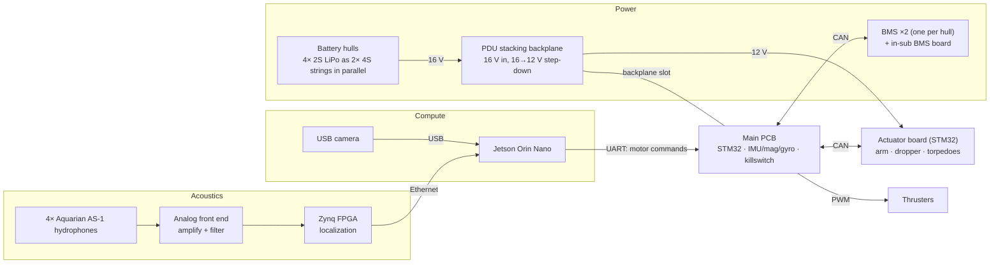

# System Overview (2026–27)

How the major boards and computers on Ogopogo connect. Each block has its own page under `Systems/`; each arrow should have a page under `Interfaces/`.

Not placed on the diagram yet: acoustic modem (main sub ↔ minisub), magnetic task, leak sensor.

## Interfaces
| Link | Bus | Spec |
| ---- | --- | ---- |
| Jetson → Main PCB | UART | [MCU-to-Jetson UART](../Interfaces/MCU-to-Jetson%20UART.md) |
| Main PCB ↔ Actuator board, BMS | CAN | [CAN Bus](../Interfaces/CAN%20Bus.md) |
| Zynq → Jetson | Ethernet | TBD |
| Main PCB → Thrusters | PWM | TBD |
| PDU backplane | Power + signals | TBD |

## Systems
See [Index](../Index.md) or the `Systems` view in `Tracker.base`.
